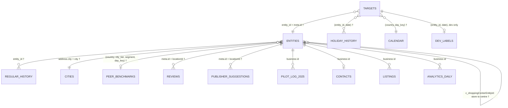

# Connect Suggests – Customer Approves

Since AI Hackathon 2026 × Fonecta · Turku, 6–8 Nov 2026

Local businesses forget to enter holiday and special-day opening hours, so Google, Apple Maps and other channels show "open" while the door is locked. Our system turns Fonecta Connect from a dashboard owners must remember to visit into a proactive assistant: it **detects** which business × date will show wrong hours, **suggests** the right hours with a reason, **contacts** the owner, lets them **decide** in one tap without logging in, and **applies** the change through the Yext API.

> **Status:** Part A (prediction engine) is in progress. Parts B–E are placeholders.

| Part | What it does | Status |
|---|---|---|
| **A. Prediction engine** | For every (business, date): `SUGGEST` + hours, `NO_ACTION`, or `FLAG`, with a reason | 🚧 In progress |
| B. Contact & decide | Message the owner, one-tap approve / edit / decline | ⏳ Planned |
| C. Apply | Read → merge → write → verify on Yext, confirm where the hours show | ⏳ Planned |
| D. Learning & standing permission | Learn from edits and declines, earn "handle holidays without asking" | ⏳ Planned |
| E. Demo, pitch & submission | Video, pitch deck, final messages, live-source bonus | ⏳ Planned |

---

## Repository layout

```
.
├── README.md              ← this file
├── AGENTS.md              ← rules and context for AI coding agents
├── CLAUDE.md              ← imports AGENTS.md for Claude Code
├── DATASET_ANALYSIS.md    ← what each dataset file is and what it is for
├── PROMPT_SOLUTION.md     ← prompts for the coordinator and the hypothesis agents (Part A)
├── result/                ← our solution, one folder per part (work order A → E)
│   ├── A_prediction_engine/
│   │   ├── model.py           ← our engine, from examples/baseline.py
│   │   ├── EXPERIMENTS.md     ← every change we tried, with scores (merged by the human)
│   │   ├── experiments/       ← one log per parallel hypothesis branch (to be created)
│   │   └── analysis/          ← error_report.py etc. (to be created)
│   ├── B_contact_decide/
│   ├── C_apply_yext/
│   ├── D_learning_permission/
│   └── E_demo_submission/
├── outputs/               ← generated prediction files
├── predictions_2026.csv   ← final predictions for the organisers' scorer (to be created)
│
├── data/  evaluation/  labels/  examples/  mock_api/  docs/
│                          ← organisers' dataset (unchanged)
```

## Part A — Prediction engine

### Quick start

Requirements: Python 3.9+. The baseline and our engine use only the standard library (`pip install pandas pyarrow` only if the analytics file is used).

Organisers' guide to the dataset: [`START_HERE.md`](START_HERE.md). Data dictionary, demo storylines, assumptions and the live-source guide are in [`docs/`](docs/). This README follows `docs/README_TEMPLATE.md`.

```bash
# 1. Organisers' baseline (reference, never edited)
python examples/baseline.py --season 2026
python evaluation/evaluate.py --predictions outputs/baseline_predictions_2026.csv

# 2. Our engine: 2026 season and the honest 2025 back-test
python result/A_prediction_engine/model.py --season 2026        # → outputs/ours_2026.csv
python evaluation/evaluate.py --predictions outputs/ours_2026.csv

python result/A_prediction_engine/model.py --season 2025        # → outputs/ours_2025.csv
python evaluation/evaluate.py --predictions outputs/ours_2025.csv --labels labels/dev_labels_2025_backtest.csv

# 3. Error breakdown
python result/A_prediction_engine/analysis/error_report.py --predictions outputs/ours_2026.csv
```

### The task

Scenario clock: today is **Fri 6 Nov 2026**; everything up to 5 Nov is known. Predict **7 Nov 2026 → 6 Jan 2027** (Father's Day, Black Friday, Independence Day, Lucia, Christmas, INTERDAY, New Year, Epiphany, plus event nights and school breaks).

| Action | Meaning |
|---|---|
| `SUGGEST` + hours | What the channels show will be wrong, so send a ready-made fix |
| `NO_ACTION` | What the channels show is already right, so stay quiet |
| `FLAG` | Needs a human, for example the business looks closed for good |

Output format: one row per action for rows of `evaluation/targets_2026.csv`; rows not listed count as `NO_ACTION`. `confidence` is optional. The organisers score the hidden **test** rows; the final `predictions_2026.csv` keeps the dev rows too so it can be checked locally with `python evaluation/evaluate.py --predictions predictions_2026.csv`.

```
entity_id,date,action,hours,confidence
FI-0123,2026-12-25,SUGGEST,closed,0.92
FI-0456,2026-12-24,SUGGEST,09:00-12:00,0.81
FI-0789,2026-12-26,FLAG,,0.70
```

`hours` is `closed` or one or more `HH:MM-HH:MM` intervals joined by commas.

### Scoring

Score = 100 × total points ÷ number of rows whose truth is SUGGEST or FLAG.

| Truth | Our action | Points |
|---|---|---|
| Needs a change | exact hours | **+1** |
| | same state, both ends within ±30 min | +0.6 |
| | same state, further off | +0.2 |
| | wrong open/closed state | **−1** |
| | FLAG | +0.05 |
| Already correct | stay quiet | 0 |
| | suggest what is already shown | −0.1 |
| | suggest other hours | −0.5 |
| | suggest the wrong state | −1 |
| | FLAG | −0.1 |
| Closed for good | FLAG | **+1** |
| | suggest closed | +0.3 |
| | suggest open | −1 |
| | stay quiet | 0 |

Because a wrong state costs as much as a perfect answer earns, **silence is a valid answer** when the engine is unsure.

### Data relationships

How the files join. Keys marked † are confirmed in `examples/baseline.py`; the others come from the dataset analysis and should be checked against the file headers.



| File | Join key | What Part A takes from it |
|---|---|---|
| `evaluation/targets_2026.csv` | `entity_id, date, day_key` | The questions to answer |
| `data/entities.json` | `meta.id` | Country, city, segment, shopping-centre link, `closed` flag |
| `data/regular_hours_history.jsonl` | `entity_id` | Weekly hours published before the snapshot, including seasonal closures |
| `data/holiday_hours_history.jsonl` | `(entity_id, date)` | Exceptions entered before the snapshot; the latest entry wins |
| `data/calendar_special_days.csv` | `(country, day_key)` | Maps this season's date to last season's date (seasons start in February) |
| `data/cities.csv` | `city` | `city_tier` for peer lookup |
| `data/peer_benchmarks.csv` | `(country, city_tier, segment, day_key)` | What similar businesses entered: closed shares and median hours |
| `data/reviews.json` | `locationId` | Closure complaints (closed for good, closed on a holiday) |
| `data/publisher_suggestions.json` | `locationId` | Public edits; about half are noise |
| `labels/*` | `(entity_id, date)` | **Evaluation and analysis only, never used to predict** |

**What the channels show** on a date = the latest holiday entry made before the snapshot, or, if there is none or it says `isRegularHours`, the published regular hours for that weekday.

### Decision cascade

Current version (= organisers' baseline). Updated as experiments land.

1. **Closed for good?** A closure review or a closure edit suggestion → `FLAG`.
2. **Shopping centre** has entered hours for the date → follow the centre.
3. **Last year** the business entered hours for the same `day_key` → copy them.
4. **Peers** (no history): suggest `closed` if ≥ 70 % of peers who entered something were closed and ≥ 15 % of all peers entered closed.
5. Suggest only if the candidate differs from what is shown; otherwise stay quiet.

### Results

| Version | Dev 2026 | Back-test 2025 | Exact precision | Recall | Wrong state |
|---|---|---|---|---|---|
| Organisers' baseline | 54.49 | 53.23 | 0.901 | 0.590 | 224 |
| Ours #0 (baseline reproduced) | 54.49 | 53.23 | 0.901 | 0.590 | 224 |

Full history in [`EXPERIMENTS.md`](result/A_prediction_engine/EXPERIMENTS.md).

### Customers with no history

_TBD: how the engine behaves when a business has never entered exceptions (showcase: demo business `FI-D0017`)._

### Key data sources

_TBD: the 3–5 most important sources, where Connect would get them in production, and what we tried that did not work._

| Source | Used for | Production origin |
|---|---|---|
| Holiday-hours history | Copy last year's exceptions | Connect audit log |
| Entities (regular hours, centre link) | What is shown now | Yext Knowledge Graph *Entities: List* |
| Peer benchmarks | Fallback for no history | Connect's own aggregated customer data |
| Reviews | Closure and closed-door complaints | Yext *Reviews: List* |
| Publisher suggestions | Public edits (weak signal) | Yext *Listings › Publisher Suggestions* |
| _…_ | | |

---

## Part B — Contact & decide

_Placeholder._

## Part C — Apply to Yext

_Placeholder._ `examples/yext_client.py` reads `YEXT_BASE_URL` and `YEXT_API_KEY`. Local mock: `python mock_api/server.py` (`http://localhost:8787`, `POST /mock/reset` undoes writes). Sandbox: `YEXT_BASE_URL=https://sbx-api.yextapis.com`, version `v=20261101` (as in `examples/yext_client.py` and `mock_api/server.py`). Use the mock for detection and the sandbox to demo the write path.

## Part D — Learning & standing permission

_Placeholder._

## Part E — Demo, pitch & submission

_Placeholder._

---

## Libraries and licences

| Component | Licence | Used in |
|---|---|---|
| Python standard library | PSF | Part A |
| Organisers' starter code (`examples/`, `evaluation/`, `mock_api/`) | MIT | Baseline, scoring, mock API |
| Synthetic dataset | CC BY 4.0 | All parts |

No GPL or AGPL components are used without Fonecta's written approval.

## Security

Credentials are read from environment variables only (`YEXT_API_KEY`, `YEXT_BASE_URL`). No API keys in code, commits, logs, screenshots or videos.