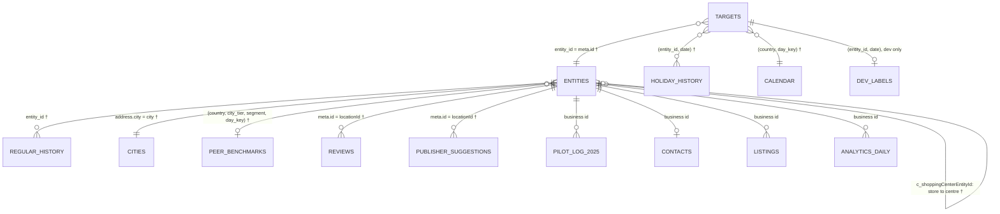

# Porchlight – Connect Suggests, Customer Approves

Since AI Hackathon 2026 × Fonecta · Turku, 6–8 Nov 2026 · team repository `Pbi-with-love/SinceAI-Porchlight`

Local businesses forget to enter holiday and special-day opening hours, so Google, Apple Maps and other channels show
"open" while the door is locked. Porchlight **detects** which business × date will show wrong hours, **suggests** the
right hours with a reason, **contacts** the owner on Telegram or with a no-login web link, lets them **decide** in one
tap, and **applies** the change through the Yext API, verified by reading it back, with Undo.

| Part | What it does | Where | Status |
|---|---|---|---|
| **A. Prediction engine** | `SUGGEST` + hours, `NO_ACTION` or `FLAG` for every (business, date), with basis, evidence and confidence | [`result/A_prediction_engine/`](result/A_prediction_engine/) | ✅ dev 2026 **65.92** · back-test 2025 **62.73** (baseline 54.49 · 53.23) |
| **B. Contact & decide** | Bundles per owner (routes SUGGEST / ASK / AUTO_APPLY / STAFF), Telegram messages, the no-login owner app | [`result/B_contact_decide/`](result/B_contact_decide/), [`result/n8n/`](result/n8n/) | ✅ live with Supabase + n8n |
| **C. Apply to Yext** | Read → merge → write → read back on the Yext sandbox, `apply_log`, Undo, where the hours show | [`result/n8n/`](result/n8n/) (`Connect · Apply to Yext`), [`result/C_apply_yext/`](result/C_apply_yext/) | ✅ verified on sandbox entity `SinceAI13` |
| **D. Standing permission** | Owner turns automatic updates on / off; only HIGH-confidence suggestions are auto-applied | [`result/D_learning_permission/`](result/D_learning_permission/) | ✅ permission · ⏳ learning from decisions not built |
| **E. Demo & submission** | Video, pitch deck, screenshots | [`result/E_demo_submission/`](result/E_demo_submission/) | ⏳ video and deck to come |

Owner app: **https://since-ai-porchlight.vercel.app** (the root page needs a signed owner link once the server has
Supabase keys; locally it runs in demo mode without keys).

---

## Run it

Python 3.9+ and the standard library only for everything in Python. Node 22+ for the owner app.

```bash
# A. Prediction engine and scores (no keys needed)
python result/A_prediction_engine/model.py --season 2026 --out ./predictions_2026.csv
python evaluation/evaluate.py --predictions predictions_2026.csv
python result/A_prediction_engine/model.py --season 2025          # honest back-test → outputs/ours_2025.csv
python evaluation/evaluate.py --predictions outputs/ours_2025.csv --labels labels/dev_labels_2025_backtest.csv

# B. Bundles for the 17 demo businesses (no keys; writes samples/bundles_demo.json and a readable summary)
python result/B_contact_decide/build_bundles.py

# Owner app in demo mode (no keys)
cd result/B_contact_decide/owner_app && npm install && npm run dev      # prints the local URL
```

The live loop needs keys in a git-ignored `.env` at the repo root (never committed): `SUPABASE_URL`,
`SUPABASE_SERVICE_KEY`, `YEXT_API_KEY`, `YEXT_BASE_URL`, `N8N_WEB_ACTION_URL`, `LINK_SECRET`, plus the n8n workflows in
[`result/n8n/`](result/n8n/) imported into an n8n instance with Supabase, Telegram and Gemini credentials.

```bash
set -a && . ./.env && set +a
python3 result/C_apply_yext/reset.py                                    # clean the Yext sandbox entity
python3 result/B_contact_decide/load_to_supabase.py --reset --chat-id <telegram-chat-id> --yext-entity SinceAI13 --only FI-D0017
python3 result/B_contact_decide/owner_link.py FI-D0017 --base https://since-ai-porchlight.vercel.app   # no-login link
```

Then run `Connect · Step 3 Contact` (or `Connect · Scheduler`) in n8n to send the Telegram messages. Deploying the
owner app: [`result/B_contact_decide/owner_app/README.md`](result/B_contact_decide/owner_app/README.md).

## The five steps

1. **Detect** — `model.py` decides, for every business and special day from 7 Nov 2026 to 6 Jan 2027, whether the hours
   shown will be wrong, using only data from before the 6 Nov snapshot.
2. **Suggest** — each suggestion carries hours, a basis (last year, two seasons ago, the owner's own pattern, the
   shopping centre, similar businesses), readable evidence and a confidence level measured on dev data.
   `build_bundles.py` groups them per owner: HIGH/MEDIUM → `SUGGEST`; peer-only or very old → `ASK` (a question);
   standing permission + all HIGH → `AUTO_APPLY`; closed for good → `STAFF` (never sent to the owner).
3. **Contact** — `Connect · Scheduler` (daily, 10:00 Helsinki) picks the day: first message 14 days before the deadline
   (next holiday − slowest channel − 1 day), one reminder. `Connect · Step 3 Contact` sends the Telegram message in the
   owner's language; opted-out owners are skipped.
4. **Decide (no login)** — in Telegram: buttons, or free text ("26.12 auki 10–14") read by Gemini and checked by rules,
   with a confirm card. On the web: the signed link `/o/<business>?t=<token>` opens a swipe deck (approve / skip / edit,
   undo). Both write `final_hours` and `decisions` in Supabase.
5. **Apply and confirm** — `Connect · Apply to Yext` reads the entity, replaces only the bundle's holiday dates, writes,
   reads back and compares, logs hours before and after in `apply_log`, and tells the owner where the new hours show
   (Google ~2 min, Facebook ~10 min, Apple Maps ~2 days, from `listings.json`). Undo restores the exact previous hours.

## Data sources that mattered most

| Source | How we used it | Where Connect would get it in production |
|---|---|---|
| **Holiday-hours history** (`holiday_hours_history.jsonl`) | Last season, two seasons back, the owner's own pattern; filtered by `entered_at` < snapshot | Connect's own audit log of exception hours entered by owners, support and accepted suggestions |
| **Entities and regular hours** (`entities.json`, `regular_hours_history.jsonl`) | What the channels show now; regular days off; the shopping-centre link | Yext Knowledge Graph *Entities* (`hours`, `holidayHours`), Connect's history of published hours |
| **Peer benchmarks** (`peer_benchmarks.csv`) and the **calendar** (`calendar_special_days.csv`) | Fallback for businesses with no history (asked, not proposed); which dates to check per country and the holiday names in each language | Connect's aggregated customer entries, dated by season; holiday APIs plus Connect's list of eves and commercial days |
| **Customer contacts** (`customer_contacts.csv`) | Owner's first name and preferred language for the message, opt-out (never contacted) and standing permission (AUTO_APPLY) | Connect's CRM: contact person, language, consent and permission flags |
| **Listings** (`listings.json`) | Which channels each business is live on and how fast each updates: sets the contact deadline and the "your hours will show on…" message | Yext *Listings* (publisher status and typical update speed) |

Closed-for-good signals come from `reviews.json` and `publisher_suggestions.json` (→ `FLAG` for staff).

## What we tried that didn't work

Every attempt is scored on both seasons with the organisers' evaluator; the full log with numbers is
[`result/A_prediction_engine/EXPERIMENTS.md`](result/A_prediction_engine/EXPERIMENTS.md) (summary table at the top).

- **INTERDAY date mapping (#1).** The baseline's "last date wins" loop is a real bug, but it never changes a suggestion: no business had differing entries across last season's days between Christmas and New Year (0 of 24). Rejected by the error report before any code was written.
- **FLAG needs two signals (#6).** Dev 2026 has zero unneeded FLAGs, so a second signal could only lose correct ones. Not implemented.
- **Two-season agreement filter** (tested inside #2). Rows where two older seasons agree are 85 % exact and 5 % wrong state, against 86 % and 8 % with one season. When the seasons disagree, the newer one is right on 14 of 17. It is not a useful filter.
- **Peer special hours (#3).** Suggesting peers' median special hours gained +0.09 / +0.15 on paper, but 72–78 % of those messages were not needed or proposed wrong hours, and it showed no gain on the independent 2024 season. Reverted: peer data cannot tell *which* business keeps special hours.
- **A looser owner pattern** (closed on 75 % of other holidays instead of all). It helped only the back-test (dev −0.10) and added 46 / 48 wrong-state rows. Reverted. Special hours, minor eves and the days between holidays cannot be predicted from an owner's other entries: on both seasons it was a coin flip or worse.
- **A habit table learned from the organisers' training data** (`dev_truth_history.csv`, 5-fold out of sample, time-cut per season). As an extra step before the peer rule, it gained only +0.03 / +0.09 (7 exact rows). Where it is confident, the peer rule already gives the same answer, and the missed closures are not a type-level habit. **Replacing** the peer rule with it removed 90–140 wrong-state rows per season but lost 0.4–4.8 points. Not merged: the gain is within noise and does not justify a learner script reading labels plus 1.9 MB of tables (EXPERIMENTS.md #4).
- **K nearest businesses by holiday behaviour** (`hyp/knn-behavior`, 96 configurations in a grid fixed beforehand, two neighbour sources, out of sample with 5 folds by business). For rows with no own history, it asked the businesses that behave most like this one on the holidays they entered. The best cell scored 65.80 / 62.79 against 65.92 / 62.73 and raised wrong state from 383 / 377 to 415 / 409; **0 of 96 cells pass the keep rule**. Where it suggested `closed` it was right 33 times and wrong 30 on dev. Not merged (EXPERIMENTS.md #5; code on the pushed branch).
- **Why the remaining misses stay with the owner.** Both learning experiments (#4 and #5) fail for the same reason: what is left are days around the major holidays that owners rarely enter, and each business treats them differently, often with an early closing time nobody but the owner knows. The product asks the owner for these rows instead of guessing.
- **Undated peer benchmarks** (AGENTS.md fix #12). The organisers' file mixes seasons 2023–2025, so the back-test of any peer-driven rule may be optimistic. It cannot be fixed from this data.
- **Conclusion: the peer rule is the main source of wrong-state suggestions.** It produces 251 of the 760 wrong-state rows over both seasons, and 23 % of its suggestions flip open/closed. Its exact closures are still worth more than its errors cost. **In the product, a suggestion based only on peers is sent to the owner as a question (ASK), not as a proposal.** `explain_full()` marks it `confidence: LOW`, or `MEDIUM` when the peer cell is very sure (≥ 85 % of peers that entered hours were closed and ≥ 25 % of all peers entered closed: 93 % exact, 7 % wrong state). Suggestions from the business's own history are `HIGH`.
- **Not done before the freeze:** the correctness fixes #10 (timezone-free review cutoff) and #11 (the 2026 `closed` flag used in the 2025 back-test). Neither is expected to change a score.

Product side:

- **Approving per bundle on the web.** The Telegram router approves a whole bundle; a swipe deck decides one date at a
  time. Reusing the router would have meant faking Telegram updates, so the web app has its own small workflow
  (`Connect · Web action`) that reuses the same `Apply to Yext`.
- **Sending requests as fast as the owner swipes.** Each Yext write takes a few seconds and the workflow answers `BUSY`
  meanwhile; the app now sends one request at a time in swipe order.
- **Proposing old entries.** Suggestions from one entry three or more seasons back (`OLDER_SEASON`, 16 % wrong state)
  are asked as a question with the real year ("In 2023 you were closed on this day. What about this year?").

## Customer with no history

When a business has never entered exception hours (showcase: `FI-D0017` Kahvila Kipinä, Turku, a new customer since 12 Oct 2026), the history rules (steps 3–5) have nothing to work with. Only the centre, closed-for-good and peer rules can act, so the engine **suggests only what similar businesses make near-certain and stays quiet otherwise**. For Kahvila Kipinä:

| Date | Shown | Engine | Evidence |
|---|---|---|---|
| 25 Dec (Christmas Day) | 08:00–17:00 | `SUGGEST closed` | 86 % of similar cafés (FI, large city) that entered hours were closed |
| 26 Dec (Boxing Day) | 10:00–16:00 | `SUGGEST closed` | 62 % of them were closed; 21 % of all entered closed |
| 1 Jan (New Year's Day) | 08:00–17:00 | `SUGGEST closed` | 76 % of them were closed |
| 11 other dates (eves, days between holidays, Black Friday…) | regular hours | stay quiet | peers are not decisive; a wrong open/closed guess costs as much as a right one earns |

Across dev 2026, the 6,626 rows with no history for their `day_key` end as: 4,848 correctly quiet, 540 exact suggestions, 133 wrong state, 1,073 still missed (3 of them closed for good). The product asks the owner where the engine is unsure, rather than guessing.

What the owner sees: Christmas Day (86 % of peers closed, confidence MEDIUM) is proposed in a `SUGGEST` message; the
two less certain days (confidence LOW) are asked, not proposed. In Telegram (route `ASK`):

```text
Hei Aino!
Kahvila Kipinä: Haluamme varmistaa aukioloaikanne tulevina pyhinä. Nyt näkyy → ehdotus:
• Tapaninpäivä, la 26.12.: 10:00–16:00 → suljettu (samankaltaisten yritysten tapa)
• Uudenvuodenpäivä, pe 1.1.: 08:00–17:00 → suljettu (samankaltaisten yritysten tapa)
Kerro meille: suljettu, auki kuten tavallisesti vai muokkaa?
```

and in the owner app, one card per day with the reason and the confidence in words:


The owner's answer is stored as their own entry, so next season the business has history and gets a HIGH-confidence
suggestion instead of a question.

## Final customer messages (as text)

All messages, in Finnish, Swedish, Norwegian and English, are in
[`result/B_contact_decide/MESSAGES.md`](result/B_contact_decide/MESSAGES.md), generated from the texts the system sends
(`build_bundles.py` templates and the n8n `Connect · Reply` dictionary). Two examples:

```text
Hei Aleksi!
Kahvila Aurora: aukioloaikasi saattavat olla väärin tulevina pyhinä. Ehdotamme näitä muutoksia (nyt → ehdotus):
• Jouluaatto, to 24.12.: 07:30–18:00 → 07:30–13:00 (omat tietosi viime vuodelta)
• Joulupäivä, pe 25.12.: 07:30–18:00 → suljettu (omat tietosi viime vuodelta)
• Uudenvuodenpäivä, pe 1.1.: 07:30–18:00 → suljettu (omat tietosi viime vuodelta)
• Loppiainen, ke 6.1.: 07:30–18:00 → 10:00–16:00 (omat tietosi kahden vuoden takaa)
Hyväksytkö muutokset? Voit myös muokata tai hylätä ne.
[✅ Hyväksy] [✏️ Muokkaa] [❌ Ei kiitos]
```

Follow-ups (English): approve → "✅ Updated! Your new hours will show on:" plus one line per channel · edit → "How would
you like to change it? Type freely, e.g. "26 Dec open 10–14", or pick below." · decline → "OK, we won't change anything.
Will you be open as usual on those days?" · undo → "↩️ Change undone. Your previous hours are back."

## Bonus: live source

Not done. The Yext sandbox is used to write, not as a data source.

---

## Part A in detail

### The task

Scenario clock: today is **Fri 6 Nov 2026**; everything up to 5 Nov is known. Predict **7 Nov 2026 → 6 Jan 2027** (Father's Day, Black Friday, Independence Day, Lucia, Christmas, INTERDAY, New Year, Epiphany, plus event nights and school breaks).

| Action | Meaning |
|---|---|
| `SUGGEST` + hours | What the channels show will be wrong, so send a ready-made fix |
| `NO_ACTION` | What the channels show is already right, so stay quiet |
| `FLAG` | Needs a human, for example the business looks closed for good |

Output format: one row per action for rows of `evaluation/targets_2026.csv`; rows not listed count as `NO_ACTION`. `confidence` is optional. The organisers score the hidden **test** rows; the final `predictions_2026.csv` keeps the dev rows too so it can be checked locally with `python evaluation/evaluate.py --predictions predictions_2026.csv`.

```
entity_id,date,action,hours,confidence
FI-0123,2026-12-25,SUGGEST,closed,0.92
FI-0456,2026-12-24,SUGGEST,09:00-12:00,0.81
FI-0789,2026-12-26,FLAG,,0.70
```

`hours` is `closed` or one or more `HH:MM-HH:MM` intervals joined by commas.

### Scoring

Score = 100 × total points ÷ number of rows whose truth is SUGGEST or FLAG.

| Truth | Our action | Points |
|---|---|---|
| Needs a change | exact hours | **+1** |
| | same state, both ends within ±30 min | +0.6 |
| | same state, further off | +0.2 |
| | wrong open/closed state | **−1** |
| | FLAG | +0.05 |
| Already correct | stay quiet | 0 |
| | suggest what is already shown | −0.1 |
| | suggest other hours | −0.5 |
| | suggest the wrong state | −1 |
| | FLAG | −0.1 |
| Closed for good | FLAG | **+1** |
| | suggest closed | +0.3 |
| | suggest open | −1 |
| | stay quiet | 0 |

Because a wrong state costs as much as a perfect answer earns, **silence is a valid answer** when the engine is unsure.

### Data relationships

How the files join. Keys marked † are confirmed in `examples/baseline.py`; the others come from the dataset analysis and should be checked against the file headers.



| File | Join key | What Part A takes from it |
|---|---|---|
| `evaluation/targets_2026.csv` | `entity_id, date, day_key` | The questions to answer |
| `data/entities.json` | `meta.id` | Country, city, segment, shopping-centre link, `closed` flag |
| `data/regular_hours_history.jsonl` | `entity_id` | Weekly hours published before the snapshot, including seasonal closures |
| `data/holiday_hours_history.jsonl` | `(entity_id, date)` | Exceptions entered before the snapshot; the latest entry wins |
| `data/calendar_special_days.csv` | `(country, day_key)` | Maps this season's date to last season's date (seasons start in February) |
| `data/cities.csv` | `city` | `city_tier` for peer lookup |
| `data/peer_benchmarks.csv` | `(country, city_tier, segment, day_key)` | What similar businesses entered: closed shares and median hours |
| `data/reviews.json` | `locationId` | Closure complaints (closed for good, closed on a holiday) |
| `data/publisher_suggestions.json` | `locationId` | Public edits; about half are noise |
| `labels/*` | `(entity_id, date)` | **Evaluation and analysis only, never used to predict** |

**What the channels show** on a date = the latest holiday entry made before the snapshot, or, if there is none or it says `isRegularHours`, the published regular hours for that weekday.

### Decision cascade (final, tag `part-a-freeze`)

The first rule that produces a candidate wins. Every suggestion carries a `basis` and human-readable evidence (`explain()` / `explain_full()` in `model.py`). `explain_full()` also returns a confidence level for Part B: **HIGH** for the business's own history (steps 3–5) and the shopping centre, **MEDIUM** for very sure peers and closed-for-good flags, and **LOW** for other peer-only suggestions, which the product sends as a question.

1. **Closed for good** (`CLOSED_SIGNALS`): a closure review or a closure edit from Google or another publisher → `FLAG` for a human.
2. **Shopping centre** (`SHOPPING_CENTRE`): the centre has entered hours for the date → follow the centre.
3. **Last season** (`LAST_YEAR`): the business entered hours for the same `day_key` last season → copy them.
4. **Two seasons back** (`TWO_YEARS_AGO`), or the newest older season (`OLDER_SEASON`): matched by the history's own `day_key`, not the calendar, which starts in 2024. If the old day opened as usual and closed early, the opening moves to today's regular opening. Skipped when the date is now a regular day off. An old "regular hours" entry falls through to the next rule.
5. **Owner's own pattern** (`OWNER_PATTERN`): the business never entered this public holiday or major eve, but it was closed on **all** of the ≥ 2 other such holidays it entered, and ≥ 30 % of similar businesses that entered hours were closed → `closed`. An entry for a same-season sibling date (e.g. another day between Christmas and New Year) is copied.
6. **Peers** (`PEERS`): only on public holidays and major eves (`day_class` MAJOR, EVE_MAJOR, SOFT), never for round-the-clock businesses. Suggest `closed` if ≥ 50 % of similar businesses (country, city tier, segment) that entered hours were closed and ≥ 15 % of all of them entered closed.
7. Suggest only if the candidate differs from what the channels show; otherwise stay quiet.

### Results

Each row is `main` after that merge. Each merge was checked for byte-identical reruns, passed a snapshot audit (every history row used was entered before the season's snapshot), and kept only if both seasons improved.

| Version | Dev 2026 | Back-test 2025 | Exact precision (dev / bt) | Recall (dev / bt) | Wrong state (dev / bt) | Missed (dev / bt) |
|---|---|---|---|---|---|---|
| Organisers' baseline | 54.49 | 53.23 | 0.901 / 0.899 | 0.590 / 0.578 | 224 / 249 | 2,038 / 2,167 |
| + two seasons back (#2) | 64.68 | 60.79 | 0.866 / 0.884 | 0.720 / 0.664 | 339 / 296 | 1,246 / 1,622 |
| + owner's own pattern (#5) | 65.42 | 61.69 | 0.865 / 0.879 | 0.730 / 0.678 | 353 / 327 | 1,185 / 1,523 |
| **+ peer tuning (#3 + #4) = final** | **65.92** | **62.73** | 0.861 / 0.873 | 0.741 / 0.698 | 383 / 377 | 1,099 / 1,369 |

Findability (dev 2026, from `evaluate.py`): search views protected on wrong-hours days rose from **57.2 % to 73.3 %**, and "shown open, actually closed" views prevented rose from **69.2 % to 84.7 %**.

- **`OLDER_SEASON` is measured on dev only.** It is worth +3.23 on dev 2026. The back-test cannot measure it, because the data has no season before 2023. We kept it because it is the same logic as `TWO_YEARS_AGO`, not a tuned parameter. Without it, the two-year step scored 61.45 instead of 64.68 on dev, with the same back-test (measured on that branch, not on the final engine).
- **Peer tuning was kept on a thin margin.** The freeze rule was "dev gains at least +0.5 and the back-test does not drop". Peer tuning gained +0.500185 on dev, which passes by less than one row.
- **Back-test caveat.** `peer_benchmarks.csv` aggregates seasons 2023–2025 with no dates, so rules that read it (steps 5 and 6) may see the 2025 season during the 2025 back-test. Trust the dev 2026 gains more than the back-test gains for those steps.

Full history, including reverted attempts: [`EXPERIMENTS.md`](result/A_prediction_engine/EXPERIMENTS.md) and the per-branch logs in [`experiments/`](result/A_prediction_engine/experiments/). Final error reports: [`analysis/reports/`](result/A_prediction_engine/analysis/reports/).

### Trade-off: more wrong-state suggestions

The engine now catches far more wrong listings, at the cost of more wrong guesses:

| Dev 2026 | Baseline | Final | Change |
|---|---|---|---|
| Exact suggestions | 3,171 | 3,982 | **+811** |
| Missed (needed a change, stayed quiet) | 2,038 | 1,099 | **−939** |
| Wrong open/closed state | 224 | 383 | **+159** |
| Exact precision | 0.901 | 0.861 | −0.040 |

On the back-test, exact suggestions rose from 3,267 to 3,945 and wrong state from 249 to 377. We accept this because **the product never publishes a suggestion on its own**: every `SUGGEST` goes to the owner with its evidence, to approve, edit or decline in one tap (Part B). A wrong suggestion costs the owner a few seconds and a "decline". A missed one sends a customer to a locked door, and the owner never hears about it. Standing permission (Part D) should only auto-apply the most reliable bases, such as last season and the shopping centre, and never a peer-only guess.

---


---

## Repository layout

```
.
├── README.md                     ← this file
├── AGENTS.md, CLAUDE.md          ← rules and context for AI coding agents
├── predictions_2026.csv          ← final predictions for the organisers' scorer
├── result/
│   ├── DATASET_ANALYSIS.md       ← what each dataset file is for
│   ├── A_prediction_engine/      ← model.py, EXPERIMENTS.md, experiments/, analysis/, PROMPT_SOLUTION.md
│   ├── B_contact_decide/         ← build_bundles.py, load_to_supabase.py, owner_link.py, MESSAGES.md, samples/
│   │   └── owner_app/            ← the no-login owner app (TanStack Start, deployed on Vercel)
│   ├── C_apply_yext/             ← sandbox reset script for the Yext entity
│   ├── D_learning_permission/    ← standing permission (where it lives), learning (not built)
│   ├── E_demo_submission/        ← demo material and screenshots
│   └── n8n/                      ← the eight n8n workflow exports and WEB_ACTION.md
├── outputs/                      ← generated files (git-ignored)
└── data/ evaluation/ labels/ examples/ mock_api/ docs/   ← organisers' dataset (unchanged)
```

## Libraries and licences

### Code and data

| Component | Licence | Used in |
|---|---|---|
| Python standard library | PSF | Part A engine, Part B bundle builder and Supabase loader, Part C sandbox scripts (no third-party Python packages) |
| Organisers' starter code (`examples/`, `evaluation/`, `mock_api/`) | MIT | Baseline, scoring, mock API |
| Synthetic dataset (`data/`) | CC BY 4.0 | All parts |
| React, React DOM | MIT | Owner app (`result/B_contact_decide/owner_app/`) |
| TanStack Start, Router, Query (`@tanstack/*`) | MIT | Owner app: routing, server functions, SSR |
| Radix UI primitives (`@radix-ui/react-*`) | MIT | Owner app UI components |
| Tailwind CSS, `@tailwindcss/vite`, `tailwind-merge`, `tw-animate-css`, `clsx` | MIT | Owner app styling |
| `class-variance-authority` | Apache-2.0 | Owner app styling |
| Framer Motion | MIT | Owner app: swipe cards and sheets |
| Lucide icons (`lucide-react`) | ISC | Owner app action buttons |
| Zod, React Hook Form, `@hookform/resolvers`, date-fns, sonner, vaul, cmdk, embla-carousel, react-day-picker, input-otp, recharts, react-resizable-panels | MIT | Owner app scaffold (shadcn/ui components from the Lovable template) |
| Fonts Fraunces and Manrope (Google Fonts) | SIL OFL 1.1 | Owner app typography |
| Build and test tools: Vite, Nitro, Vitest, Testing Library, ESLint, Prettier, `@lovable.dev/vite-tanstack-config`, `@vitejs/plugin-react`, jsdom | MIT | Owner app build and tests only |
| TypeScript | Apache-2.0 | Owner app build only |

Checked on 2026-11-08 over all 525 installed npm packages of the owner app, including indirect ones: 448 MIT,
27 ISC, 21 Apache-2.0, 20 BSD-2/3-Clause, plus 0BSD, Unlicense (`isbot`), BlueOak-1.0.0 (`minimatch`),
Python-2.0 (`argparse`), CC-BY-4.0 (`caniuse-lite` browser data) and MPL-2.0 (`lightningcss`, a build-time CSS tool,
used unmodified). No GPL, AGPL or LGPL package.

### External services (used through their APIs, not redistributed)

| Service | Terms | Used for |
|---|---|---|
| Yext API (sandbox account provided by Fonecta) | Yext terms, sandbox credentials from Fonecta | Reading and writing holiday hours (`Connect · Apply to Yext`), `result/C_apply_yext/` |
| n8n Cloud | n8n Cloud terms of service (n8n itself: Sustainable Use License, fair-code). We use the hosted service; the workflow exports in `result/n8n/` are our own | Contact, reply, router, scheduler, web action and Yext apply workflows |
| Supabase | Supabase terms of service (platform open source, Apache-2.0) | Tables `bundles`, `bundle_items`, `decisions`, `apply_log`, `chat_sessions` |
| Telegram Bot API | Telegram Bot Platform terms | Owner and staff messages, buttons |
| Google Gemini API (Gemini 2.5 Flash) | Gemini API terms of service | Only in `Connect · Parse edit`: reading an owner's free-text hours, always followed by a rule-based validator. Predictions never use an LLM |
| Vercel | Vercel terms of service | Hosting the owner app |
| Lovable | Lovable terms of service | Generated the first UI scaffold of the owner app; the code in this repository is ours |

No GPL or AGPL components are used without Fonecta's written approval. All credentials live in environment
variables or in the services' own credential stores, never in the repository.

## Security

- Credentials are read from environment variables only (a git-ignored `.env` locally, the host's settings on Vercel) or
  live in n8n's credential store. No API keys in code, commits, logs, screenshots or videos.
- The owner app reads Supabase and calls n8n only from server functions; the browser never sees a key.
- No-login links are signed: `token = HMAC-SHA256(entity_id, LINK_SECRET)`, checked on the server; a changed business ID
  or token is refused. The server also checks that every bundle in a request belongs to that business.
- The n8n host is not in the workflow exports (`<your-n8n-host>` placeholder). The webhooks have no extra auth in this
  MVP (a decision for the hackathon); in production they need a shared secret header.