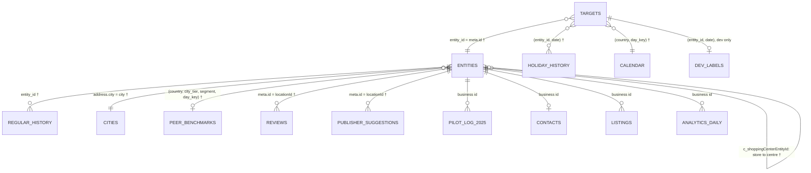

# Connect Suggests – Customer Approves

Since AI Hackathon 2026 × Fonecta · Turku, 6–8 Nov 2026

Local businesses forget to enter holiday and special-day opening hours, so Google, Apple Maps and other channels show "open" while the door is locked. Our system turns Fonecta Connect from a dashboard owners must remember to visit into a proactive assistant: it **detects** which business × date will show wrong hours, **suggests** the right hours with a reason, **contacts** the owner, lets them **decide** in one tap without logging in, and **applies** the change through the Yext API.

> **Status:** Part A (prediction engine) is **closed** at tag `part-a-final` (scores unchanged since `part-a-freeze`): **dev 2026 65.92 · back-test 2025 62.73** (organisers' baseline 54.49 · 53.23). Parts B–E are next.

| Part | What it does | Status |
|---|---|---|
| **A. Prediction engine** | For every (business, date): `SUGGEST` + hours, `NO_ACTION`, or `FLAG`, with a reason | ✅ Closed (`part-a-final`) |
| B. Contact & decide | Message the owner, one-tap approve / edit / decline | ⏳ Planned |
| C. Apply | Read → merge → write → verify on Yext, confirm where the hours show | ⏳ Planned |
| D. Learning & standing permission | Learn from edits and declines, earn "handle holidays without asking" | ⏳ Planned |
| E. Demo, pitch & submission | Video, pitch deck, final messages, live-source bonus | ⏳ Planned |

---

## Repository layout

```
.
├── README.md              ← this file
├── AGENTS.md              ← rules and context for AI coding agents
├── CLAUDE.md              ← imports AGENTS.md for Claude Code
├── DATASET_ANALYSIS.md    ← what each dataset file is and what it is for
├── PROMPT_SOLUTION.md     ← prompts for the coordinator and the hypothesis agents (Part A)
├── result/                ← our solution, one folder per part (work order A → E)
│   ├── A_prediction_engine/
│   │   ├── model.py           ← our engine, from examples/baseline.py
│   │   ├── EXPERIMENTS.md     ← every change we tried, with scores (merged by the human)
│   │   ├── experiments/       ← one log per hypothesis branch (two-year, owner-pattern, peer-tuning)
│   │   └── analysis/          ← error_report.py; reports/final_2026.txt, final_2025.txt
│   ├── B_contact_decide/
│   ├── C_apply_yext/
│   ├── D_learning_permission/
│   └── E_demo_submission/
├── outputs/               ← generated prediction files
├── predictions_2026.csv   ← final predictions for the organisers' scorer (17,351 action rows)
│
├── data/  evaluation/  labels/  examples/  mock_api/  docs/
│                          ← organisers' dataset (unchanged)
```

## Part A — Prediction engine

### Quick start

Requirements: Python 3.9+. The baseline and our engine use only the standard library (`pip install pandas pyarrow` only if the analytics file is used).

Organisers' guide to the dataset: [`START_HERE.md`](START_HERE.md). Data dictionary, demo storylines, assumptions and the live-source guide are in [`docs/`](docs/). This README follows `docs/README_TEMPLATE.md`.

```bash
# 1. Organisers' baseline (reference, never edited)
python examples/baseline.py --season 2026
python evaluation/evaluate.py --predictions outputs/baseline_predictions_2026.csv

# 2. Our engine: 2026 season and the honest 2025 back-test
python result/A_prediction_engine/model.py --season 2026        # → outputs/ours_2026.csv
python evaluation/evaluate.py --predictions outputs/ours_2026.csv

python result/A_prediction_engine/model.py --season 2025        # → outputs/ours_2025.csv
python evaluation/evaluate.py --predictions outputs/ours_2025.csv --labels labels/dev_labels_2025_backtest.csv

# 3. Error breakdown
python result/A_prediction_engine/analysis/error_report.py --predictions outputs/ours_2026.csv

# 4. Final predictions file (keep the "./": model.py needs a directory in --out)
python result/A_prediction_engine/model.py --season 2026 --out ./predictions_2026.csv
python evaluation/evaluate.py --predictions predictions_2026.csv
```

### The task

Scenario clock: today is **Fri 6 Nov 2026**; everything up to 5 Nov is known. Predict **7 Nov 2026 → 6 Jan 2027** (Father's Day, Black Friday, Independence Day, Lucia, Christmas, INTERDAY, New Year, Epiphany, plus event nights and school breaks).

| Action | Meaning |
|---|---|
| `SUGGEST` + hours | What the channels show will be wrong, so send a ready-made fix |
| `NO_ACTION` | What the channels show is already right, so stay quiet |
| `FLAG` | Needs a human, for example the business looks closed for good |

Output format: one row per action for rows of `evaluation/targets_2026.csv`; rows not listed count as `NO_ACTION`. `confidence` is optional. The organisers score the hidden **test** rows; the final `predictions_2026.csv` keeps the dev rows too so it can be checked locally with `python evaluation/evaluate.py --predictions predictions_2026.csv`.

```
entity_id,date,action,hours,confidence
FI-0123,2026-12-25,SUGGEST,closed,0.92
FI-0456,2026-12-24,SUGGEST,09:00-12:00,0.81
FI-0789,2026-12-26,FLAG,,0.70
```

`hours` is `closed` or one or more `HH:MM-HH:MM` intervals joined by commas.

### Scoring

Score = 100 × total points ÷ number of rows whose truth is SUGGEST or FLAG.

| Truth | Our action | Points |
|---|---|---|
| Needs a change | exact hours | **+1** |
| | same state, both ends within ±30 min | +0.6 |
| | same state, further off | +0.2 |
| | wrong open/closed state | **−1** |
| | FLAG | +0.05 |
| Already correct | stay quiet | 0 |
| | suggest what is already shown | −0.1 |
| | suggest other hours | −0.5 |
| | suggest the wrong state | −1 |
| | FLAG | −0.1 |
| Closed for good | FLAG | **+1** |
| | suggest closed | +0.3 |
| | suggest open | −1 |
| | stay quiet | 0 |

Because a wrong state costs as much as a perfect answer earns, **silence is a valid answer** when the engine is unsure.

### Data relationships

How the files join. Keys marked † are confirmed in `examples/baseline.py`; the others come from the dataset analysis and should be checked against the file headers.



| File | Join key | What Part A takes from it |
|---|---|---|
| `evaluation/targets_2026.csv` | `entity_id, date, day_key` | The questions to answer |
| `data/entities.json` | `meta.id` | Country, city, segment, shopping-centre link, `closed` flag |
| `data/regular_hours_history.jsonl` | `entity_id` | Weekly hours published before the snapshot, including seasonal closures |
| `data/holiday_hours_history.jsonl` | `(entity_id, date)` | Exceptions entered before the snapshot; the latest entry wins |
| `data/calendar_special_days.csv` | `(country, day_key)` | Maps this season's date to last season's date (seasons start in February) |
| `data/cities.csv` | `city` | `city_tier` for peer lookup |
| `data/peer_benchmarks.csv` | `(country, city_tier, segment, day_key)` | What similar businesses entered: closed shares and median hours |
| `data/reviews.json` | `locationId` | Closure complaints (closed for good, closed on a holiday) |
| `data/publisher_suggestions.json` | `locationId` | Public edits; about half are noise |
| `labels/*` | `(entity_id, date)` | **Evaluation and analysis only, never used to predict** |

**What the channels show** on a date = the latest holiday entry made before the snapshot, or, if there is none or it says `isRegularHours`, the published regular hours for that weekday.

### Decision cascade (final, tag `part-a-freeze`)

The first rule that produces a candidate wins. Every suggestion carries a `basis` and human-readable evidence (`explain()` / `explain_full()` in `model.py`). `explain_full()` also returns a confidence level for Part B: **HIGH** for the business's own history (steps 3–5) and the shopping centre, **MEDIUM** for very sure peers and closed-for-good flags, and **LOW** for other peer-only suggestions, which the product sends as a question.

1. **Closed for good** (`CLOSED_SIGNALS`): a closure review or a closure edit from Google or another publisher → `FLAG` for a human.
2. **Shopping centre** (`SHOPPING_CENTRE`): the centre has entered hours for the date → follow the centre.
3. **Last season** (`LAST_YEAR`): the business entered hours for the same `day_key` last season → copy them.
4. **Two seasons back** (`TWO_YEARS_AGO`), or the newest older season (`OLDER_SEASON`): matched by the history's own `day_key`, not the calendar, which starts in 2024. If the old day opened as usual and closed early, the opening moves to today's regular opening. Skipped when the date is now a regular day off. An old "regular hours" entry falls through to the next rule.
5. **Owner's own pattern** (`OWNER_PATTERN`): the business never entered this public holiday or major eve, but it was closed on **all** of the ≥ 2 other such holidays it entered, and ≥ 30 % of similar businesses that entered hours were closed → `closed`. An entry for a same-season sibling date (e.g. another day between Christmas and New Year) is copied.
6. **Peers** (`PEERS`): only on public holidays and major eves (`day_class` MAJOR, EVE_MAJOR, SOFT), never for round-the-clock businesses. Suggest `closed` if ≥ 50 % of similar businesses (country, city tier, segment) that entered hours were closed and ≥ 15 % of all of them entered closed.
7. Suggest only if the candidate differs from what the channels show; otherwise stay quiet.

### Results

Each row is `main` after that merge. Each merge was checked for byte-identical reruns, passed a snapshot audit (every history row used was entered before the season's snapshot), and kept only if both seasons improved.

| Version | Dev 2026 | Back-test 2025 | Exact precision (dev / bt) | Recall (dev / bt) | Wrong state (dev / bt) | Missed (dev / bt) |
|---|---|---|---|---|---|---|
| Organisers' baseline | 54.49 | 53.23 | 0.901 / 0.899 | 0.590 / 0.578 | 224 / 249 | 2,038 / 2,167 |
| + two seasons back (#2) | 64.68 | 60.79 | 0.866 / 0.884 | 0.720 / 0.664 | 339 / 296 | 1,246 / 1,622 |
| + owner's own pattern (#5) | 65.42 | 61.69 | 0.865 / 0.879 | 0.730 / 0.678 | 353 / 327 | 1,185 / 1,523 |
| **+ peer tuning (#3 + #4) = final** | **65.92** | **62.73** | 0.861 / 0.873 | 0.741 / 0.698 | 383 / 377 | 1,099 / 1,369 |

Findability (dev 2026, from `evaluate.py`): search views protected on wrong-hours days rose from **57.2 % to 73.3 %**, and "shown open, actually closed" views prevented rose from **69.2 % to 84.7 %**.

- **`OLDER_SEASON` is measured on dev only.** It is worth +3.23 on dev 2026. The back-test cannot measure it, because the data has no season before 2023. We kept it because it is the same logic as `TWO_YEARS_AGO`, not a tuned parameter. Without it, the two-year step scored 61.45 instead of 64.68 on dev, with the same back-test (measured on that branch, not on the final engine).
- **Peer tuning was kept on a thin margin.** The freeze rule was "dev gains at least +0.5 and the back-test does not drop". Peer tuning gained +0.500185 on dev, which passes by less than one row.
- **Back-test caveat.** `peer_benchmarks.csv` aggregates seasons 2023–2025 with no dates, so rules that read it (steps 5 and 6) may see the 2025 season during the 2025 back-test. Trust the dev 2026 gains more than the back-test gains for those steps.

Full history, including reverted attempts: [`EXPERIMENTS.md`](result/A_prediction_engine/EXPERIMENTS.md) and the per-branch logs in [`experiments/`](result/A_prediction_engine/experiments/). Final error reports: [`analysis/reports/`](result/A_prediction_engine/analysis/reports/).

### Customers with no history

When a business has never entered exception hours (showcase: `FI-D0017` Kahvila Kipinä, Turku, a new customer since 12 Oct 2026), the history rules (steps 3–5) have nothing to work with. Only the centre, closed-for-good and peer rules can act, so the engine **suggests only what similar businesses make near-certain and stays quiet otherwise**. For Kahvila Kipinä:

| Date | Shown | Engine | Evidence |
|---|---|---|---|
| 25 Dec (Christmas Day) | 08:00–17:00 | `SUGGEST closed` | 86 % of similar cafés (FI, large city) that entered hours were closed |
| 26 Dec (Boxing Day) | 10:00–16:00 | `SUGGEST closed` | 62 % of them were closed; 21 % of all entered closed |
| 1 Jan (New Year's Day) | 08:00–17:00 | `SUGGEST closed` | 76 % of them were closed |
| 11 other dates (eves, days between holidays, Black Friday…) | regular hours | stay quiet | peers are not decisive; a wrong open/closed guess costs as much as a right one earns |

Across dev 2026, the 6,626 rows with no history for their `day_key` end as: 4,848 correctly quiet, 540 exact suggestions, 133 wrong state, 1,073 still missed (3 of them closed for good). The missed ones are where Part B should **ask** the owner a one-tap question rather than guess. Once answered, that answer becomes next season's history.

### Key data sources

| Source | How we used it | Where Connect would get it in production |
|---|---|---|
| **Holiday-hours history** (`holiday_hours_history.jsonl`) | Last season, two seasons back, the owner's own pattern; filtered by `entered_at` < snapshot | Connect's own audit log of exception hours entered by owners, support and suggestions |
| **Entities and regular hours** (`entities.json`, `regular_hours_history.jsonl`) | What the channels show now; regular days off; the shopping-centre link | Yext Knowledge Graph *Entities* (`hours`, `holidayHours`), Connect's history of published hours |
| **Calendar of special days** (`calendar_special_days.csv`) | Which dates to check per country; `day_class` decides where owner and peer patterns apply | Holiday APIs (Nager.Date, the `holidays` package) plus Connect's own list of eves and commercial days |
| **Peer benchmarks** (`peer_benchmarks.csv`) | Fallback for businesses with no history | Connect's aggregated customer entries, **dated by season** so a back-test can exclude the season it tests |
| **Reviews and publisher suggestions** (`reviews.json`, `publisher_suggestions.json`) | Closed-for-good signals → `FLAG` | Yext *Reviews* and *Listings › Publisher Suggestions* |

### What didn't work

- **INTERDAY date mapping (#1).** The baseline's "last date wins" loop is a real bug, but it never changes a suggestion: no business had differing entries across last season's days between Christmas and New Year (0 of 24). Rejected by the error report before any code was written.
- **FLAG needs two signals (#6).** Dev 2026 has zero unneeded FLAGs, so a second signal could only lose correct ones. Not implemented.
- **Two-season agreement filter** (tested inside #2). Rows where two older seasons agree are 85 % exact and 5 % wrong state, against 86 % and 8 % with one season. When the seasons disagree, the newer one is right on 14 of 17. It is not a useful filter.
- **Peer special hours (#3).** Suggesting peers' median special hours gained +0.09 / +0.15 on paper, but 72–78 % of those messages were not needed or proposed wrong hours, and it showed no gain on the independent 2024 season. Reverted: peer data cannot tell *which* business keeps special hours.
- **A looser owner pattern** (closed on 75 % of other holidays instead of all). It helped only the back-test (dev −0.10) and added 46 / 48 wrong-state rows. Reverted. Special hours, minor eves and the days between holidays cannot be predicted from an owner's other entries: on both seasons it was a coin flip or worse.
- **A habit table learned from the organisers' training data** (`dev_truth_history.csv`, 5-fold out of sample, time-cut per season). As an extra step before the peer rule, it gained only +0.03 / +0.09 (7 exact rows). Where it is confident, the peer rule already gives the same answer, and the missed closures are not a type-level habit. **Replacing** the peer rule with it removed 90–140 wrong-state rows per season but lost 0.4–4.8 points. Not merged: the gain is within noise and does not justify a learner script reading labels plus 1.9 MB of tables (EXPERIMENTS.md #4).
- **K nearest businesses by holiday behaviour** (`hyp/knn-behavior`, 96 configurations in a grid fixed beforehand, two neighbour sources, out of sample with 5 folds by business). For rows with no own history, it asked the businesses that behave most like this one on the holidays they entered. The best cell scored 65.80 / 62.79 against 65.92 / 62.73 and raised wrong state from 383 / 377 to 415 / 409; **0 of 96 cells pass the keep rule**. Where it suggested `closed` it was right 33 times and wrong 30 on dev. Not merged (EXPERIMENTS.md #5; code on the pushed branch).
- **Why the remaining misses stay with the owner.** Both learning experiments (#4 and #5) fail for the same reason: what is left are days around the major holidays that owners rarely enter, and each business treats them differently, often with an early closing time nobody but the owner knows. The product asks the owner for these rows instead of guessing.
- **Undated peer benchmarks** (AGENTS.md fix #12). The organisers' file mixes seasons 2023–2025, so the back-test of any peer-driven rule may be optimistic. It cannot be fixed from this data.
- **Conclusion: the peer rule is the main source of wrong-state suggestions.** It produces 251 of the 760 wrong-state rows over both seasons, and 23 % of its suggestions flip open/closed. Its exact closures are still worth more than its errors cost. **In the product, a suggestion based only on peers is sent to the owner as a question (ASK), not as a proposal.** `explain_full()` marks it `confidence: LOW`, or `MEDIUM` when the peer cell is very sure (≥ 85 % of peers that entered hours were closed and ≥ 25 % of all peers entered closed: 93 % exact, 7 % wrong state). Suggestions from the business's own history are `HIGH`.
- **Not done before the freeze:** the correctness fixes #10 (timezone-free review cutoff) and #11 (the 2026 `closed` flag used in the 2025 back-test). Neither is expected to change a score.

### Trade-off: more wrong-state suggestions

The engine now catches far more wrong listings, at the cost of more wrong guesses:

| Dev 2026 | Baseline | Final | Change |
|---|---|---|---|
| Exact suggestions | 3,171 | 3,982 | **+811** |
| Missed (needed a change, stayed quiet) | 2,038 | 1,099 | **−939** |
| Wrong open/closed state | 224 | 383 | **+159** |
| Exact precision | 0.901 | 0.861 | −0.040 |

On the back-test, exact suggestions rose from 3,267 to 3,945 and wrong state from 249 to 377. We accept this because **the product never publishes a suggestion on its own**: every `SUGGEST` goes to the owner with its evidence, to approve, edit or decline in one tap (Part B). A wrong suggestion costs the owner a few seconds and a "decline". A missed one sends a customer to a locked door, and the owner never hears about it. Standing permission (Part D) should only auto-apply the most reliable bases, such as last season and the shopping centre, and never a peer-only guess.

---

## Part B — Contact & decide

_Placeholder._

## Part C — Apply to Yext

_Placeholder._ `examples/yext_client.py` reads `YEXT_BASE_URL` and `YEXT_API_KEY`. Local mock: `python mock_api/server.py` (`http://localhost:8787`, `POST /mock/reset` undoes writes). Sandbox: `YEXT_BASE_URL=https://sbx-api.yextapis.com`, version `v=20261106` (the organisers' mock and `examples/yext_client.py` use `v=20261101`). Setup scripts for the sandbox entity `SinceAI13`: [`result/C_apply_yext/`](result/C_apply_yext/README.md). Use the mock for detection and the sandbox to demo the write path.

## Part D — Learning & standing permission

_Placeholder._

## Part E — Demo, pitch & submission

_Placeholder._

---

## Libraries and licences

| Component | Licence | Used in |
|---|---|---|
| Python standard library | PSF | Part A |
| Organisers' starter code (`examples/`, `evaluation/`, `mock_api/`) | MIT | Baseline, scoring, mock API |
| Synthetic dataset | CC BY 4.0 | All parts |

No GPL or AGPL components are used without Fonecta's written approval.

## Security

Credentials are read from environment variables only (`YEXT_API_KEY`, `YEXT_BASE_URL`). No API keys in code, commits, logs, screenshots or videos.