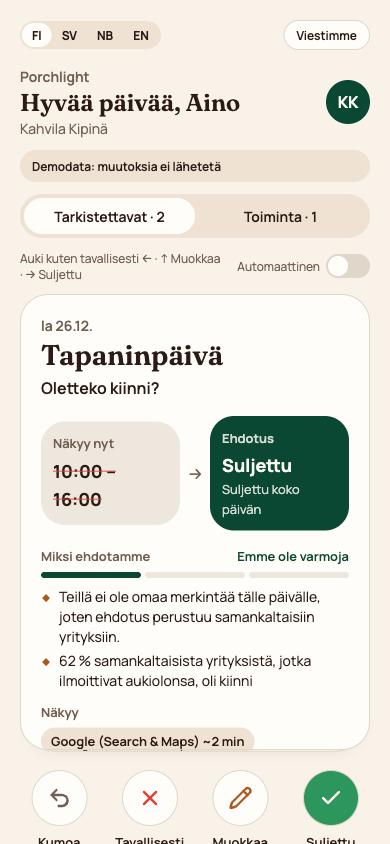

# 27xAugust – Connect Suggests (Porchlight)

Team **27xAugust** · project **Porchlight** · Since AI Hackathon 2026 × Fonecta · Turku, 6–8 Nov 2026 · repository `Pbi-with-love/SinceAI-Porchlight`

Local businesses forget to enter holiday and special-day opening hours, so Google, Apple Maps and other channels show
"open" while the door is locked. Porchlight **detects** which business × date will show wrong hours, **suggests** the
right hours with a reason, **contacts** the owner on Telegram or with a no-login web link, lets them **decide** in one
tap, and **applies** the change through the Yext API, verified by reading it back, with Undo.

| Part | What it does | Where | Status |
|---|---|---|---|
| **A. Prediction engine** | `SUGGEST` + hours, `NO_ACTION` or `FLAG` for every (business, date), with basis, evidence and confidence | [`result/A_prediction_engine/`](result/A_prediction_engine/) | ✅ dev 2026 **65.92** · back-test 2025 **62.73** (baseline 54.49 · 53.23) |
| **B. Contact & decide** | Bundles per owner (routes SUGGEST / ASK / AUTO_APPLY / STAFF), Telegram messages, the no-login owner app | [`result/B_contact_decide/`](result/B_contact_decide/), [`result/n8n/`](result/n8n/) | ✅ live with Supabase + n8n |
| **C. Apply to Yext** | Read → merge → write → read back on the Yext sandbox, `apply_log`, Undo, where the hours show | [`result/n8n/`](result/n8n/) (`Connect · Apply to Yext`), [`result/C_apply_yext/`](result/C_apply_yext/) | ✅ verified on sandbox entity `SinceAI13` |
| **D. Standing permission** | Owner turns automatic updates on / off; only HIGH-confidence suggestions are auto-applied | [`result/D_learning_permission/`](result/D_learning_permission/) | ✅ permission · ⏳ learning from decisions not built |
| **E. Demo & submission** | Demo reset script, live-calendar bonus, screenshots, video, pitch deck | [`result/E_demo_submission/`](result/E_demo_submission/) | ✅ reset script, live-source bonus, demo-business table · ⏳ video and deck |

**Links:** owner app https://since-ai-porchlight.vercel.app (opened through a signed owner link, printed by
`owner_link.py` or `reset_demo.sh`) · demo video: _to be added_ · pitch deck: _to be added_ ·
repository https://github.com/Pbi-with-love/SinceAI-Porchlight

`Connect · …` names below are our n8n workflows; Porchlight is the product.

---

## Run it

Python 3.9+, standard library only (`requirements.txt` lists pandas / pyarrow only for the optional analytics parquet; nothing in `result/` needs them). Node 22+ for the owner app.

```bash
# A. Prediction engine and scores (no keys needed)
python result/A_prediction_engine/model.py --season 2026 --out ./predictions_2026.csv
python evaluation/evaluate.py --predictions predictions_2026.csv
python result/A_prediction_engine/model.py --season 2025          # honest back-test → outputs/ours_2025.csv
python evaluation/evaluate.py --predictions outputs/ours_2025.csv --labels labels/dev_labels_2025_backtest.csv

# B. Bundles for the 17 demo businesses (no keys; writes samples/bundles_demo.json and a readable summary)
python result/B_contact_decide/build_bundles.py

# Owner app in demo mode (no keys)
cd result/B_contact_decide/owner_app && npm install && npm run dev      # prints the local URL
```

The live loop needs keys in a git-ignored `.env` at the repo root (never committed), plus the n8n workflows in
[`result/n8n/`](result/n8n/) imported into an n8n instance with Supabase, Telegram and Gemini credentials. **The
organisers receive our `.env` separately**; with it the commands below reproduce our results. To use your own
accounts, create `.env` with these variables:

| Variable | What it is | Where to get it |
|---|---|---|
| `SUPABASE_URL`, `SUPABASE_SERVICE_KEY` | The database shared with n8n | Supabase → Project settings → API (service_role key, server side only) |
| `YEXT_API_KEY`, `YEXT_BASE_URL` | Yext sandbox access (`https://sbx-api.yextapis.com`, or `http://localhost:8787` for the organisers' mock) | The sandbox credentials Fonecta gives each team |
| `YEXT_ENTITY_ID` (optional) | Sandbox entity the demo writes to, default `SinceAI13` | The Yext sandbox account |
| `N8N_WEB_ACTION_URL` | Production URL of the `Connect · Web action` webhook | n8n → that workflow → Webhook node |
| `LINK_SECRET` | Signs the no-login owner links; the owner app must use the same value | Any long random string, e.g. `openssl rand -hex 32` |
| `OWNER_APP_URL` (optional) | Where the owner app runs, for printed links | Your Vercel URL, or `http://localhost:5180` |
| `DEMO_CHAT_ID` | Telegram chat that plays the owner (a group with the bot in it) | Telegram, e.g. via the bot's updates |

The owner app on Vercel or Lovable needs `SUPABASE_URL`, `SUPABASE_SERVICE_KEY`, `N8N_WEB_ACTION_URL` and `LINK_SECRET`
as server secrets ([owner app README](result/B_contact_decide/owner_app/README.md)).

One command resets the live demo: it builds the bundles, reloads Supabase for the chosen businesses, clears the holiday
hours of the Yext sandbox entity and prints each owner's no-login link. It needs the keys above including
`DEMO_CHAT_ID`, asks before deleting anything (`--yes` skips the question), and `--dry-run` (still needs the keys)
shows the plan without changing Supabase or Yext.

```bash
./result/E_demo_submission/reset_demo.sh                    # FI-D0017 Kahvila Kipinä (default)
./result/E_demo_submission/reset_demo.sh FI-D0007 FI-D0017  # several businesses (one chat, one Yext entity)
./result/E_demo_submission/reset_demo.sh --dry-run          # nothing changed
```

The same steps by hand:

```bash
set -a && . ./.env && set +a
python3 result/C_apply_yext/reset.py                                    # clean the Yext sandbox entity
python3 result/B_contact_decide/load_to_supabase.py --reset --chat-id <telegram-chat-id> --yext-entity SinceAI13 --only FI-D0017
python3 result/B_contact_decide/owner_link.py FI-D0017 --base https://since-ai-porchlight.vercel.app   # no-login link
```

Then run `Connect · Step 3 Contact` (or `Connect · Scheduler`) in n8n to send the Telegram messages; Step 3 sends to
every bundle still `QUEUED`, so load only the businesses you want to message. Turn the Scheduler off while recording. After importing the
workflows, set your own staff Telegram chat in the `Config` node of `Step 3 Contact`, `Step 4 Telegram router` and
`Web action` (`TELEGRAM_STAFF_CHAT_ID`), and your n8n host in the `Config` node of `Connect · Scheduler`. Deploying the
owner app: [`result/B_contact_decide/owner_app/README.md`](result/B_contact_decide/owner_app/README.md).

## The five steps

1. **Detect**: `model.py` marks every business × special day (7 Nov 2026 – 6 Jan 2027) whose shown hours will be wrong, using only data from before the 6 Nov snapshot ([Part A](result/A_prediction_engine/README.md)).
2. **Suggest**: each suggestion has hours, a basis, readable evidence and a measured confidence; `build_bundles.py` groups them per owner into `SUGGEST` / `ASK` / `AUTO_APPLY` / `STAFF` ([Part B](result/B_contact_decide/README.md)).
3. **Contact**: `Connect · Scheduler` picks the day (first message 14 days before the deadline, one reminder) and `Connect · Step 3 Contact` sends the Telegram message in the owner's language; opted-out owners are skipped.
4. **Decide, no login**: Telegram buttons or free text (read by Gemini, checked by rules), or the signed web link `/o/<business>?t=<token>` with a swipe deck (approve / skip / edit / undo, [owner app](result/B_contact_decide/owner_app/README.md)).
5. **Apply and confirm**: `Connect · Apply to Yext` writes only the bundle's holiday dates, reads them back, logs before/after in `apply_log`, offers Undo and tells the owner where the hours show (Google ~2 min … Apple Maps ~2 days) ([spec](result/n8n/WEB_ACTION.md)).

## Demo businesses

The 17 storylines of `docs/DEMO_SCENARIOS.md` against what Porchlight produces: **10 ✅ · 5 ⚠️ · 2 ❌**, row by row in
[`result/E_demo_submission/DEMO_BUSINESSES.md`](result/E_demo_submission/DEMO_BUSINESSES.md). Right moves include
FI-D0011 → staff flag only, FI-D0012 → applied with standing permission, NO-D0015 (24/7) → no message, FI-D0017 → the
no-history case below. Not covered: seasonal closure (FI-D0006) and outdated regular hours (SE-D0016), which the
organisers list as signals, not scored targets; FI-D0013 gets three questions where silence would be right.

## Data sources that mattered most (3–5)

| Signal | How we used it | Where Connect would get it in production |
|---|---|---|
| **Holiday-hours history** (`holiday_hours_history.jsonl`) | Last season, two seasons back, the owner's own pattern; filtered by `entered_at` < snapshot | Connect's own audit log of exception hours entered by owners, support and accepted suggestions |
| **Entities and regular hours** (`entities.json`, `regular_hours_history.jsonl`) | What the channels show now; regular days off; the shopping-centre link | Yext Knowledge Graph *Entities* (`hours`, `holidayHours`), Connect's history of published hours |
| **Peer benchmarks** (`peer_benchmarks.csv`) and the **calendar** (`calendar_special_days.csv`) | Fallback for businesses with no history (asked, not proposed); which dates to check per country and the holiday names in each language | Connect's aggregated customer entries, dated by season; holiday APIs plus Connect's list of eves and commercial days |
| **Customer contacts** (`customer_contacts.csv`) | Owner's first name and preferred language for the message, opt-out (never contacted) and standing permission (AUTO_APPLY) | Connect's CRM: contact person, language, consent and permission flags |
| **Listings** (`listings.json`) | Which channels each business is live on and how fast each updates: sets the contact deadline and the "your hours will show on…" message | Yext *Listings* (publisher status and typical update speed) |

Closed-for-good signals come from `reviews.json` and `publisher_suggestions.json` (→ `FLAG` for staff).

## What we tried that didn't work

Every attempt was scored on both seasons with the organisers' evaluator against a keep rule set beforehand. One line
each here; numbers in [`EXPERIMENTS.md`](result/A_prediction_engine/EXPERIMENTS.md), full reasoning in the
[Part A README](result/A_prediction_engine/README.md).

- **Peer median special hours**: +0.09 / +0.15 on paper, but 72–78 % of those messages were needless or wrong. Reverted.
- **A looser owner pattern** (75 % instead of all other holidays closed): back-test only, dev −0.10, +46 / +48 wrong-state rows. Reverted.
- **Two-season agreement filter**: agreeing seasons are no more reliable (85 % vs 86 % exact). Dropped.
- **Habit table learned from the organisers' training data** (out of sample, folds by business): +0.03 / +0.09, within noise. Reverted.
- **K nearest businesses by holiday behaviour** (96 configurations): best 65.80 / 62.79 with more wrong-state rows; 0 of 96 pass the keep rule. Reverted.
- **Reviews as a closure signal** (analysis): on the rows still missed, full-day closure reviews are wrong more often than right. Not built.
- **INTERDAY date mapping** and **FLAG needs two signals**: rejected by the error report before any code (no row would change).

Known limits: `peer_benchmarks.csv` has no dates, so peer-driven back-test gains may be optimistic; the peer rule
causes 251 of the 760 wrong-state rows, which is why peer-only suggestions are asked (`ASK`), never proposed.

Product side:

- **Approving per bundle on the web.** The Telegram router approves a whole bundle; a swipe deck decides one date at a
  time. Reusing the router would have meant faking Telegram updates, so the web app has its own small workflow
  (`Connect · Web action`) that reuses the same `Apply to Yext`.
- **Sending requests as fast as the owner swipes.** Each Yext write takes a few seconds and the workflow answers `BUSY`
  meanwhile; the app now sends one request at a time in swipe order.
- **Proposing old entries.** Suggestions from one entry three or more seasons back (`OLDER_SEASON`, 16 % wrong state)
  are asked as a question with the real year ("In 2023 you were closed on this day. What about this year?").

## Customer with no history / no previous actions

When a business has never entered exception hours (showcase: `FI-D0017` Kahvila Kipinä, Turku, a new customer since 12 Oct 2026), the history rules (last year, two seasons ago, the owner's own pattern) have nothing to work with. Only the centre, closed-for-good and peer rules can act, so the engine **suggests only what similar businesses make near-certain and stays quiet otherwise**. For Kahvila Kipinä:

| Date | Shown | Engine | Evidence |
|---|---|---|---|
| 25 Dec (Christmas Day) | 08:00–17:00 | `SUGGEST closed` | 86 % of similar cafés (FI, large city) that entered hours were closed |
| 26 Dec (Boxing Day) | 10:00–16:00 | `SUGGEST closed` | 62 % of them were closed; 21 % of all entered closed |
| 1 Jan (New Year's Day) | 08:00–17:00 | `SUGGEST closed` | 76 % of them were closed |
| 11 other dates (eves, days between holidays, Black Friday…) | regular hours | stay quiet | peers are not decisive; a wrong open/closed guess costs as much as a right one earns |

Across dev 2026, the 6,626 rows with no history for their `day_key` end as: 4,848 correctly quiet, 540 exact suggestions, 133 wrong state, 1,073 still missed (3 of them closed for good) and 32 other outcomes (other hours or needless messages). The product asks the owner where the engine is unsure, rather than guessing.

What the owner sees: Christmas Day (86 % of peers closed, confidence MEDIUM) is proposed in a `SUGGEST` message; the
two less certain days (confidence LOW) are asked, not proposed. In Telegram (route `ASK`):

```text
Hei Aino!
Kahvila Kipinä: Haluamme varmistaa aukioloaikanne tulevina pyhinä. Nyt näkyy → ehdotus:
• Tapaninpäivä, la 26.12.: 10:00–16:00 → suljettu (samankaltaisten yritysten tapa)
• Uudenvuodenpäivä, pe 1.1.: 08:00–17:00 → suljettu (samankaltaisten yritysten tapa)
Kerro meille: suljettu, auki kuten tavallisesti vai muokkaa?
```

and in the owner app, one card per day with the reason and the confidence in words:



Once the owner answers, the approved hours are written to Yext and become the business's own entry, so next season it
has history and will get a HIGH-confidence suggestion instead of a question.

## Final customer messages (as text)

[`result/B_contact_decide/MESSAGES.md`](result/B_contact_decide/MESSAGES.md) lists every message, generated from the
texts the system sends: first messages from the `build_bundles.py` templates (fi / sv / nb from the demo businesses;
English uses the same template), all follow-ups, reminders and buttons in four languages from the n8n
`Connect · Reply` dictionary. One first message per language, then the follow-ups:

```text
Hei Aleksi!
Kahvila Aurora: aukioloaikasi saattavat olla väärin tulevina pyhinä. Ehdotamme näitä muutoksia (nyt → ehdotus):
• Jouluaatto, to 24.12.: 07:30–18:00 → 07:30–13:00 (omat tietosi viime vuodelta)
• Joulupäivä, pe 25.12.: 07:30–18:00 → suljettu (omat tietosi viime vuodelta)
• Uudenvuodenpäivä, pe 1.1.: 07:30–18:00 → suljettu (omat tietosi viime vuodelta)
• Loppiainen, ke 6.1.: 07:30–18:00 → 10:00–16:00 (omat tietosi kahden vuoden takaa)
Hyväksytkö muutokset? Voit myös muokata tai hylätä ne.
[✅ Hyväksy] [✏️ Muokkaa] [❌ Ei kiitos]
```

Swedish (`ASK`, Restaurang Fyren, SE-D0016):

```text
Hej Per!
Restaurang Fyren: Vi vill dubbelkolla era öppettider under kommande helgdagar. Nu visas → förslag:
• Julafton, tors 24/12: 11:00–23:00 → stängt (så gör liknande företag)
• Juldagen, fre 25/12: 11:00–23:00 → stängt (så gör liknande företag)
• Nyårsdagen, fre 1/1: 11:00–23:00 → stängt (så gör liknande företag)
Berätta för oss: stängt, öppet som vanligt eller ändra?
[🔒 Stängt] [🕘 Öppet som vanligt] [✏️ Ändra]
```

Norwegian (`SUGGEST`, Bakeri Fjord, NO-D0009):

```text
Hei Marte!
Bakeri Fjord: åpningstidene dine kan være feil de kommende helligdagene. Vi foreslår disse endringene (nå → forslag):
• Første juledag, fre 25.12.: 07:00–18:00 → stengt (dine egne opplysninger fra i fjor)
• Første nyttårsdag, fre 1.1.: 07:00–18:00 → stengt (dine egne opplysninger for to år siden)
Godkjenner du endringene? Du kan også endre eller avslå dem.
[✅ Godkjenn] [✏️ Endre] [❌ Nei takk]
```

English (fallback for owners without fi / sv / nb; the Kahvila Aurora bundle above, same template, `language = en`):

```text
Hi Aleksi!
Kahvila Aurora: your opening hours may be wrong on the coming holidays. We suggest these changes (now → proposed):
• Christmas Eve, Thu 24 Dec: 07:30–18:00 → 07:30–13:00 (your own entry last year)
• Christmas Day, Fri 25 Dec: 07:30–18:00 → closed (your own entry last year)
• New Year's Day, Fri 1 Jan: 07:30–18:00 → closed (your own entry last year)
• Epiphany, Wed 6 Jan: 07:30–18:00 → 10:00–16:00 (your own entry two years ago)
Do you approve? You can also edit or decline them.
[✅ Approve] [✏️ Edit] [❌ No thanks]
```

Follow-ups (Finnish, as sent in the demo): approve → "✅ Päivitetty! Uudet ajat näkyvät pian:" plus one line per
channel and the offer "Hoidetaanko juhlapyhät jatkossa puolestasi? Saat aina ilmoituksen ja voit perua." · edit →
"Miten haluat muuttaa? Kirjoita vapaasti, esim. "26.12. auki 10–14", tai valitse alta." · decline → "Selvä, emme
muuta mitään. Oletteko silloin auki normaalisti?" · undo → "↩️ Muutos peruttu. Aiemmat ajat ovat taas voimassa."

Follow-ups (English): approve → "✅ Updated! Your new hours will show on:" plus one line per channel · edit → "How would
you like to change it? Type freely, e.g. "26 Dec open 10–14", or pick below." · decline → "OK, we won't change anything.
Will you be open as usual on those days?" · undo → "↩️ Change undone. Your previous hours are back."

## Bonus: live source

We replaced `data/calendar_special_days.csv` with the live **Nager.Date** API (`date.nager.at`, public holidays of
FI, SE and NO for 2024–2027) and ran the unchanged engine on it: script and full report in
[`result/E_demo_submission/live_calendar/`](result/E_demo_submission/live_calendar/REPORT.md).

| Calendar | Dev 2026 | Back-test 2025 |
|---|---|---|
| Organisers' file (reference) | 65.92 | 62.73 |
| Nager only | 61.38 | 57.16 |
| Nager + our own eves, days between holidays and commercial days | 65.92 | 62.73 |

- **Coverage:** all 116 public holidays in the organisers' file are in Nager on the same date, and Nager already lists
  the next season (39 days in 2027).
- **Quality:** right dates, different meaning and names: Christmas Eve, Midsummer Eve and (in Sweden) New Year's Eve
  are public holidays in Nager but behave as eves for opening hours; names differ (`St. Stephen's Day` vs
  `Boxing Day`), so a fixed name map is needed.
- **Gaps:** Nager has only public holidays. The 107 other rows (41 eves, 27 days between Christmas and New Year, 21
  observances, 18 commercial days) are missing, and they are where hours go wrong most; without them the engine
  loses 4.5 / 5.6 points.
- **Production design:** public holidays from a live API, eves and commercial days from Connect's own rules. This
  gives exactly the reference scores.

## Third-party code, data and licences

### Code and data

| Component | Licence | Used in |
|---|---|---|
| Python standard library | PSF | Part A engine, Part B bundle builder and Supabase loader, Part C sandbox scripts (no third-party Python packages) |
| Organisers' starter code (`examples/`, `evaluation/`, `mock_api/`) | MIT | Baseline, scoring, mock API |
| Synthetic dataset (`data/`) | CC BY 4.0 | All parts |
| Nager.Date public-holiday API (`date.nager.at`), cached in `result/E_demo_submission/live_calendar/nager_cache.json` | MIT (Nager.Date project) | Bonus: live calendar |
| React, React DOM | MIT | Owner app (`result/B_contact_decide/owner_app/`) |
| TanStack Start, Router, Query (`@tanstack/*`) | MIT | Owner app: routing, server functions, SSR |
| Radix UI primitives (`@radix-ui/react-*`) | MIT | Owner app UI components |
| Tailwind CSS, `@tailwindcss/vite`, `tailwind-merge`, `tw-animate-css`, `clsx` | MIT | Owner app styling |
| `class-variance-authority` | Apache-2.0 | Owner app styling |
| Framer Motion | MIT | Owner app: swipe cards and sheets |
| Lucide icons (`lucide-react`) | ISC | Owner app action buttons |
| Zod, React Hook Form, `@hookform/resolvers`, date-fns, sonner, vaul, cmdk, embla-carousel, react-day-picker, input-otp, recharts, react-resizable-panels | MIT | Owner app scaffold (shadcn/ui components from the Lovable template) |
| Fonts Fraunces and Manrope (Google Fonts) | SIL OFL 1.1 | Owner app typography |
| Build and test tools: Vite, Nitro, Vitest, Testing Library, ESLint, Prettier, `@lovable.dev/vite-tanstack-config`, `@vitejs/plugin-react`, jsdom | MIT | Owner app build and tests only |
| TypeScript | Apache-2.0 | Owner app build only |

Checked on 2026-11-08 over all 525 installed npm packages of the owner app, including indirect ones: 448 MIT,
27 ISC, 21 Apache-2.0, 20 BSD-2/3-Clause, plus 0BSD, Unlicense (`isbot`), BlueOak-1.0.0 (`minimatch`),
Python-2.0 (`argparse`), CC-BY-4.0 (`caniuse-lite` browser data) and MPL-2.0 (`lightningcss`, a build-time CSS tool,
used unmodified). No GPL, AGPL or LGPL package.

### External services (used through their APIs, not redistributed)

| Service | Terms | Used for |
|---|---|---|
| Yext API (sandbox account provided by Fonecta) | Yext terms, sandbox credentials from Fonecta | Reading and writing holiday hours (`Connect · Apply to Yext`), `result/C_apply_yext/` |
| n8n Cloud | n8n Cloud terms of service (n8n itself: Sustainable Use License, fair-code). We use the hosted service; the workflow exports in `result/n8n/` are our own | All eight workflows: Step 3 contact, Step 4 Telegram router, reply, parse edit, apply to Yext, scheduler, web action, eval harness |
| Supabase | Supabase terms of service (platform open source, Apache-2.0) | Tables `bundles`, `bundle_items`, `decisions`, `apply_log`, `chat_sessions` |
| Telegram Bot API | Telegram Bot Platform terms | Owner and staff messages, buttons |
| Google Gemini API (Gemini 2.5 Flash) | Gemini API terms of service | Only in `Connect · Parse edit`: reading an owner's free-text hours, always followed by a rule-based validator. Predictions never use an LLM |
| Vercel | Vercel terms of service | Hosting the owner app |
| Lovable | Lovable terms of service | Generated the first UI scaffold of the owner app; the code in this repository is ours |

No GPL or AGPL components are used without Fonecta's written approval. All credentials live in environment
variables or in the services' own credential stores, never in the repository.

## Repository layout

```
.
├── README.md                     ← this file
├── AGENTS.md, CLAUDE.md          ← rules and context for AI coding agents
├── predictions_2026.csv          ← final predictions for the organisers' scorer
├── requirements.txt, LICENSE.md  ← optional analytics packages; organisers' licence
├── result/
│   ├── README.md                 ← one line per folder
│   ├── DATASET_ANALYSIS.md       ← what each dataset file is for
│   ├── A_prediction_engine/      ← model.py, EXPERIMENTS.md, experiments/, analysis/, PROMPT_SOLUTION.md
│   ├── B_contact_decide/         ← build_bundles.py, load_to_supabase.py, owner_link.py, MESSAGES.md, samples/
│   │   └── owner_app/            ← the no-login owner app (TanStack Start, deployed on Vercel)
│   ├── C_apply_yext/             ← sandbox reset script for the Yext entity
│   ├── D_learning_permission/    ← standing permission (where it lives), learning (not built)
│   ├── E_demo_submission/        ← reset_demo.sh, live_calendar/ (bonus), DEMO_BUSINESSES.md, media/
│   └── n8n/                      ← the eight n8n workflow exports and WEB_ACTION.md
├── outputs/                      ← generated files (git-ignored)
└── data/ evaluation/ labels/ examples/ mock_api/ docs/   ← organisers' dataset (unchanged)
```

## Security

- Credentials are read from environment variables only (a git-ignored `.env` locally, the host's settings on Vercel) or
  live in n8n's credential store. No API keys in code, commits, logs, screenshots or videos.
- The owner app reads Supabase and calls n8n only from server functions; the browser never sees a key.
- No-login links are signed: `token = HMAC-SHA256(entity_id, LINK_SECRET)`, checked on the server; a changed business ID
  or token is refused. The server also checks that every bundle in a request belongs to that business.
- The n8n host is not in the workflow exports (`<your-n8n-host>` placeholder). The webhooks have no extra auth in this
  MVP (a decision for the hackathon); in production they need a shared secret header.